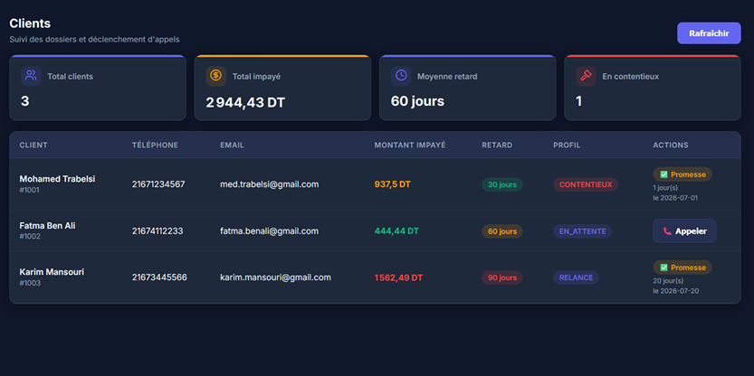
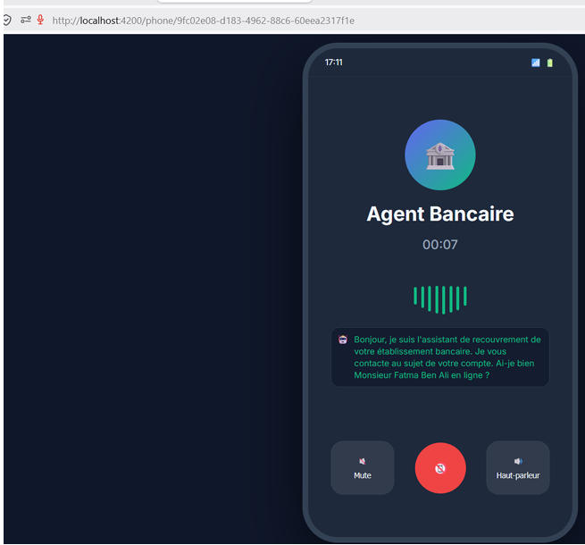
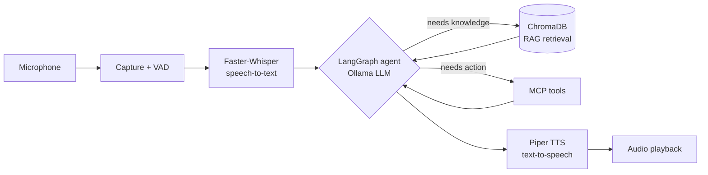

# Voice-Agent: Local Agentic Voice Assistant

> 🇫🇷 **En bref :** assistant vocal IA *local-first*. Il écoute, cherche dans une base documentaire (RAG), raisonne et appelle des outils (LangGraph + MCP), puis répond à voix haute. Réalisé comme base de mon projet de fin d'études chez TALYS Consulting (agent vocal de recouvrement bancaire).

A local-first, end-to-end **voice AI agent**. It listens, retrieves knowledge from documents, reasons over multiple steps, calls external tools through MCP, and speaks back, all orchestrated as an agentic workflow rather than a single prompt-response loop.

## Screenshots

<p align="center">
  
  
</p>

**Frontend (Angular dashboard):** [voice-agent-front](https://github.com/MedKhalil55/voice-agent-front)
## Key features

- **Fully local pipeline**: speech-to-text, LLM and text-to-speech run on your machine (Faster-Whisper, Ollama, Piper).
- **Agentic orchestration** with **LangGraph**: the agent decides when to retrieve, when to call a tool and when to answer.
- **RAG** over your own documents with **ChromaDB**, so answers are grounded in source content.
- **MCP (Model Context Protocol)** tool calling: the agent can act, not only generate text.
- **Low-latency voice UX**: stop-on-silence recording, streaming partial transcripts, model warm-up and tunable latency knobs.

## Architecture



1. **Capture**: record microphone audio (WAV or streaming chunks).
2. **Transcribe**: speech-to-text with Whisper (`faster-whisper`).
3. **Retrieve**: pull relevant context from the RAG pipeline backed by ChromaDB.
4. **Reason and orchestrate**: a LangGraph agent graph drives multi-step reasoning over an LLM served by Ollama.
5. **Act**: invoke external tools and capabilities through MCP.
6. **Synthesize**: convert the answer back to speech with Piper TTS.
7. **Play**: play the audio response to the user.

## Quick start

```bash
# 1. Clone
git clone https://github.com/MedKhalil55/voice-agent.git
cd voice-agent

# 2. Configure (see the Configuration section below)
cp .env.example .env

# 3. Make sure Ollama is running and a model is pulled
ollama pull <your-model>

# 4. Run
uv run main.py
```


### Prerequisites

- Python 3.12 and [`uv`](https://docs.astral.sh/uv/)
- [Ollama](https://ollama.com) installed and running (default: `http://localhost:11434`)
- A [Piper](https://github.com/rhasspy/piper) voice model (`.onnx` + `.onnx.json`)
- ChromaDB for the RAG layer
- An MCP-compatible tool/server configuration

## Results


| Metric | Value | How it was measured |
|---|---|---|
| End-to-end latency per turn | _TBD_ | _e.g. average over N turns on <hardware>_ |
| STT time (Whisper) | _TBD_ | |
| LLM time (LangGraph + Ollama) | _TBD_ | |
| TTS time (Piper) | _TBD_ | |
| RAG answer accuracy | _TBD_ | _e.g. N test questions, manually verified_ |
| Tool-calling success rate | _TBD_ | _e.g. N scenarios_ |

**Test hardware:** _TBD_

## Configuration

Create a `.env` file in the project root (same folder as `main.py`):

```ini
# --- TTS (Piper) ---
VOICE_AGENT_PIPER_BIN=/path/to/piper            # e.g. C:\path\to\piper.exe on Windows
VOICE_AGENT_PIPER_MODEL=voices/en_US-lessac-medium.onnx
VOICE_AGENT_PIPER_CONFIG=voices/en_US-lessac-medium.onnx.json

# --- LLM (Ollama) ---
VOICE_AGENT_OLLAMA_MODEL=qwen2.5                # use the model you actually pulled
VOICE_AGENT_OLLAMA_BASE_URL=http://localhost:11434

# --- STT (Faster-Whisper) ---
VOICE_AGENT_WHISPER_MODEL=small.en
VOICE_AGENT_WHISPER_LANGUAGE=en
VOICE_AGENT_WHISPER_COMPUTE_TYPE=int8
VOICE_AGENT_WHISPER_BEAM_SIZE=1

# --- Audio recording ---
# Stop recording after N seconds of silence.
VOICE_AGENT_RECORD_STOP_ON_SILENCE_SECONDS=3

# Optional
# VOICE_AGENT_RECORD_MAX_SECONDS=30
# VOICE_AGENT_SILENCE_RMS_THRESHOLD=0.01
# VOICE_AGENT_MIN_RECORD_SECONDS=0.6
# VOICE_AGENT_AUDIO_INPUT_DEVICE=1
# VOICE_AGENT_AUDIO_INPUT_DEVICE=Microphone (Realtek(R) Audio)

# --- RAG (ChromaDB) and MCP ---
# TODO: list the real variable names used by the final version, for example:
# VOICE_AGENT_CHROMA_PATH=./chroma_db
# VOICE_AGENT_MCP_CONFIG=./mcp_servers.json
```

Notes:
- Relative paths such as `voices/...` are resolved from the project root.
- On Windows, using `VOICE_AGENT_PIPER_BIN` (standalone Piper) avoids common Python phonemizer issues.

## Streaming transcription (real-time partials)

A pseudo-streaming mode is also included. It:

- captures the microphone in 0.5 s float32 chunks,
- keeps audio in memory (no temporary WAV files),
- uses a lightweight VAD for start/end detection,
- prints partial transcripts while you speak, then a final transcript.

```bash
uv run streaming_demo.py
```

Tip: if the wrong microphone is used, set `VOICE_AGENT_AUDIO_INPUT_DEVICE` in `.env`. Outputs are written to `artifacts/` (for example `artifacts/user.wav` and `artifacts/assistant.wav`).

## Tuning and troubleshooting

<details>
<summary><b>Troubleshooting speech-to-text</b> (wrong language, hearing the assistant)</summary>

- If you speak English but the transcript comes out in another language, set `VOICE_AGENT_WHISPER_LANGUAGE=en` and optionally use an English-only model such as `VOICE_AGENT_WHISPER_MODEL=small.en`.
- If the transcript seems to capture the assistant's own voice, your input device may be wrong (for example Windows "Stereo Mix"). Listen to `artifacts/user.wav` to confirm what was recorded, then set `VOICE_AGENT_AUDIO_INPUT_DEVICE` to your real microphone.

</details>

<details>
<summary><b>Dynamic recording</b> (stop on silence)</summary>

Recording can stop automatically when you stop speaking instead of waiting a fixed duration.

- Enable: `VOICE_AGENT_RECORD_STOP_ON_SILENCE_SECONDS=3`
- It cuts off while you are still talking: increase `VOICE_AGENT_RECORD_MAX_SECONDS` (for example `60`).
- It stops too early: lower `VOICE_AGENT_SILENCE_RMS_THRESHOLD` (for example `0.005`).
- It never stops: raise `VOICE_AGENT_SILENCE_RMS_THRESHOLD` (for example `0.02`).

</details>

<details>
<summary><b>Latency tuning</b> (phone-call UX)</summary>

Total latency is roughly the sum of:

- the stop-on-silence delay (often 1 to 3 s),
- STT decode time (Whisper),
- agent reasoning time (LangGraph + LLM, plus any RAG retrieval or MCP tool calls),
- TTS synthesis time (Piper).

**1. Recording**

```ini
VOICE_AGENT_RECORD_STOP_ON_SILENCE_SECONDS=1.2          # faster turn-taking
VOICE_AGENT_TRIM_TRAILING_SILENCE=true                  # less audio to transcribe
VOICE_AGENT_TRAILING_SILENCE_PADDING_SECONDS=0.25
```

**2. STT (Whisper)**

```ini
VOICE_AGENT_WHISPER_MODEL=medium                        # keep for quality
VOICE_AGENT_WHISPER_BEAM_SIZE=3
VOICE_AGENT_WHISPER_BEST_OF=1

# Skip STT on near-silent audio
VOICE_AGENT_SKIP_STT_ON_SILENCE=true
VOICE_AGENT_SKIP_STT_RMS_THRESHOLD=0.003

# Optional faster-whisper toggles
VOICE_AGENT_WHISPER_WITHOUT_TIMESTAMPS=true
VOICE_AGENT_WHISPER_VAD_FILTER=true
VOICE_AGENT_STT_USE_NUMPY_WAV=true
```

**3. LLM / agent (Ollama + LangGraph)**

```ini
VOICE_AGENT_OLLAMA_NUM_PREDICT=120                      # shorter answers (try 96)
VOICE_AGENT_OLLAMA_NUM_CTX=2048                         # smaller context window
VOICE_AGENT_OLLAMA_KEEP_ALIVE=10m                       # keep the model loaded
```

**4. Warm-up**

STT and LLM are warmed up in a background thread while the greeting plays, which reduces first-turn latency. Disable with `VOICE_AGENT_WARMUP=false`.

</details>

## Quick TTS smoke test

Loads `.env` and synthesizes a WAV file:

```bash
uv run python -c "from dotenv import load_dotenv; load_dotenv(); from tts import synthesize_speech; synthesize_speech('Hello!', 'artifacts/tts_test.wav')"
```

## Tech stack

Python · Faster-Whisper · Ollama · LangGraph · LangChain · ChromaDB · MCP · Piper TTS · FastAPI · Angular (dashboard)

## Context

This project started as a local voice-assistant experiment and evolved into a testbed for agentic AI patterns (LangGraph orchestration, RAG retrieval and MCP tool calling) on a real-time voice interface. It is the foundation for the voice-agent architecture I developed during my final-year internship at TALYS Consulting. This repository contains only my own code and no company or customer data.


## Author

**Mohamed Khalil Boukadida**, software engineer (ESPRIT)
[GitHub](https://github.com/MedKhalil55) · [LinkedIn](https://linkedin.com/in/mohamed-khalil-boukadida) · mohamedkhalil.boukadida@esprit.tn
